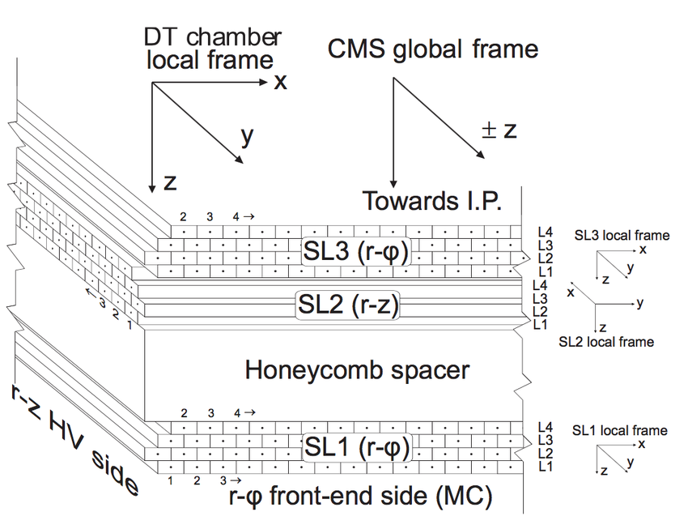

geometry
=========

This module provides tools to manage geometrical objects in the context of CMS DT detectors.

The CMS DTs geometry is stored in a XML file -
(:download:`DTGeometry_v3.xml <../../_static/DTGeometry_v3.xml>`). The
:class:`~mpldts.geometry.sources.cms_xml.CMSXMLSource` below is the only
reader of it: it returns a ``StationSpec`` per chamber, and a station that is not
in the XML is described with the same specs by hand.

.. code-block:: python

    from mpldts.geometry import Station
    from mpldts.geometry.sources import CMSXMLSource

    source = CMSXMLSource()                       # the XML is parsed once
    chamber = Station.from_spec(source.station(-2, 1, 2), -2, 1, 2)
    chamber.super_layer(1).layer(1).cell(1).local_center

Since version 2.3 the model is built in four layers: an XML source produces
immutable specs, a builder turns a spec into a node tree with one pose per
node, and a frame graph resolves the transforms. :doc:`./runtime` documents that
architecture and its API. The classes below (:doc:`./station`,
:doc:`./super_layer`, :doc:`./layer`, :doc:`./drift_cell`) are views over it: a
chamber is a tree of super layers, layers and cells, and ``DTFrame`` provides
bounds, centres and ids.

The following image shows the composition of a CMS DT chamber and indicates how the reference frames 
for each component are defined. Transformations between these frames are possible with the help of the
``TranforManager`` class (see `Transforms`_ below).

.. toctree::
    :maxdepth: 1
    :caption: Submodules
    :name: geometry-submodules

    runtime
    station
    super_layer
    layer
    drift_cell

.. note::
    Every drift cell centre is read from the XML once, when the source is
    constructed. A station view is built from its spec, so creating many of them
    is cheap.

.. note::
    3.0 deleted the XML-backed classes: ``DTGeometry``, ``DTGEOMETRY`` and
    ``StationsCache`` are gone. The source, the specs and the views on this page
    are the whole API; :doc:`./runtime` has the list of what was removed and what
    replaced it.

Classes
-------
- :ref:`DTFrame`

.. _DTFrame:

DTFrame
*******

.. autoclass:: mpldts.geometry.DTFrame
    :member-order: bysource
    :members:
    :special-members: __init__

Other utils
-----------
- :ref:`Transforms`

.. _Transforms:

Transforms
***********
The ``transforms`` module provides utility functions for computing geometrical properties, such as the 
pseudo-rapidity of a point given its global position. Most importantly, it includes the 
``TransformManager`` class, which is instantiated by each DT component to handle transformations 
between local, parent, and global reference frames.

.. automodule:: mpldts.geometry.transforms
    :members:
    :special-members: __init__

.. note::
    ``TransformManager`` is the legacy entry point. The runtime model resolves the
    same transforms through the frame graph with the node poses; see
    :doc:`./runtime`.

.. note::
    This documentation supports multiple versions. Use the version selector in the top-right corner to switch between versions.
